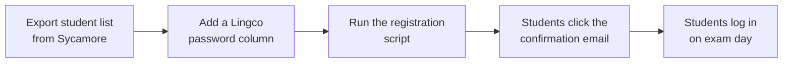

# AATG exam registration

!!! note "Placeholder"

    This page collects what we know so far. Parts of it may be out of date.
    If you run the registration this year, please update it.
    Click **Edit this page** (:material-file-edit-outline:).

## What is AATG?

The **AATG** (American Association of Teachers of German) runs the
**National German Exam**, which many GSSB students take each year. The exam
is taken online through a test provider. Recently that provider was
**Lingco** ([class.lingco.io](https://class.lingco.io/)).

## Why IT is involved

To take the exam, every student needs an account with the test provider.
Signing up on their own means each student types their name, email, and a
password, which is three chances to make a typo. The test provider has no
"upload a list" option, so GSSB IT pre-registers students in bulk instead.

## How it works

1. **Export the student list from Sycamore** (our school database) as a
   spreadsheet. It's the same list we already make for AATG: first name,
   last name, and the student's `student.gssb.org` email address.
2. **Add a password for each student** in a new column for the test
   provider account.
3. **Run the registration script.** It reads the spreadsheet and creates an
   account for each student. For each row it reports whether the account was
   created or already existed.
4. **Students confirm.** Each student gets an email at their
   `student.gssb.org` address and clicks the confirmation link.
5. **Students log in** with their `student.gssb.org` email and the
   password from step 2.

The script lives in the
[AATGRegistration](https://github.com/it-gssb/AATGRegistration) repository.
Running it needs some technical setup. Ask the IT team.

!!! danger "The student spreadsheet is personal data"

    It has student names, emails, and passwords. **Never** upload it to
    GitHub, this site, or any shared chat. Keep it only where the IT team
    tells you to, and delete local copies when registration is done.

## Open questions

<!-- TODO: fill these in when known. -->

- Which test provider is AATG using this year?
- How are the student passwords chosen, and how are they given to students?
- When does registration need to be finished?

## Owner

GSSB IT team. Open an issue in the
[repository](https://github.com/it-gssb/it-gssb.github.io/issues) or ask in
the IT volunteers' channel.

## Last verified

Not yet verified (placeholder, based on the 2022–2023 registration script).
