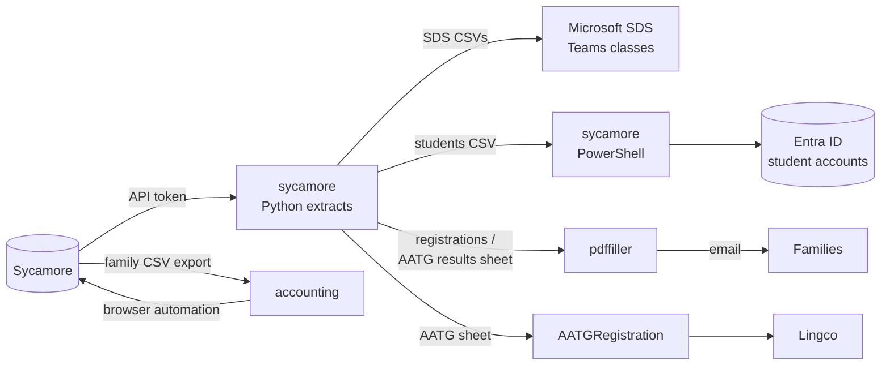

# IT scripts overview

This section covers the code in the [it-gssb GitHub organization](https://github.com/it-gssb).
It's written for software engineers who are new to GSSB: what each repo is
for, when it gets used, and how to run it.

!!! danger "These scripts handle personal data"

    Most of them read or write student and family records: names, emails,
    addresses, passwords. Keep inputs and outputs on your own machine. Never
    commit them, never paste them into issues or chat, and delete them when
    you're done. Pass tokens and passwords on the command line only. Never
    put them in files inside a repo.

## Background

New to GSSB? Read [About GSSB](../about-gssb.md) first. It has the roles,
the school-year calendar, and a glossary.

- **Sycamore** ([sycamoreschool.com](https://www.sycamoreschool.com/)) is
  GSSB's school information system and the source of truth for families,
  students, classes, teachers, and billing.
- **Microsoft 365 / Entra ID** hosts the `student.gssb.org` student accounts.
  **Microsoft School Data Sync (SDS)** turns Sycamore class lists into Teams
  classes.
- The **IT / Registrar** member of the School Committee owns these
  scripts (`it@gssb.org`).
- The **AATG** National German Exam happens once a year. See
  [AATG exam registration](../aatg/index.md).

## Repos

| Repo | Language | Used for | When | Activity |
| :--- | :------- | :------- | :--- | :------- |
| [sycamore](sycamore.md) | Python, PowerShell | Exporting Sycamore data for SDS, Entra accounts, registration lists, AATG | Summer and start of year, then whenever enrollment changes | Active (2026) |
| [pdffiller](pdffiller.md) | Java | Filling PDF forms from a spreadsheet and emailing them in bulk (AATG certificates, enrollment letters) | Acceptance letters (summer), AATG certificates (spring) | Stable (2025) |
| [accounting](accounting.md) | Java | Posting tuition charges to Sycamore family accounts and creating invoices | Once a year, after registration (spring) | Stable (2025) |
| [AATGRegistration](aatg-registration.md) | Python | Creating students' exam accounts with the test provider (Lingco) in bulk | Once a year, before the January exam | Dormant (2023) |
| [it-gssb.github.io](https://github.com/it-gssb/it-gssb.github.io) | Markdown | This site | Any time | Active |

## How they fit together

## Processes end to end

Each process is a chain of steps run by hand. Nothing is scheduled, and
files move between steps on your own machine. Steps marked *(inferred)*
come from reading the code and commit history; nobody has confirmed them.

### 1. Student accounts and Teams classes (late August, then whenever enrollment changes)

1. Check the data: `sycamore/src/extract/ValidateRegistrationData.py`.
   Fix any reported names in Sycamore first. Student email addresses are
   built from names, so a stray space or comma turns into a bad address.
2. Delete groups older than one year: `delete-groups.ps1`.
3. Export students: `ExtractStudents.py` writes `azure-ad-students.csv`.
4. Create the missing accounts with `create-students.ps1`, then enable
   enrolled students and disable everyone else with
   `set-students-accountenabled.ps1`.
5. Start of year only: reset passwords to the welcome-letter default with
   `set-students-password.ps1`.
6. Export SDS files: `ExtractFromSycamoreToSDS21.py`. Upload them to SDS,
   which creates the Teams classes and links students, teachers, and
   parents.

Entra accounts are created **before** SDS runs. SDS v2.1 only matches
existing accounts, using `activeDirectoryMatchId` (the email address).

### 2. Acceptance letters (summer)

1. Run `ExtractForRegistration.py --xlsx`. It writes one row per student
   per class, with the class, room, teacher, parent names and emails,
   address, custom fields, and the family's parent-helper assignment.
2. Run [pdffiller](pdffiller.md) with `excel.group_columns` starting at
   `FamilyCode`. Each family gets one email with all of their children's
   class assignments. Default recipients are `PrimaryParentEmail` and
   `SecondaryParentEmail`. *(The exact templates aren't in any repo.)*

### 3. Tuition invoicing (spring, after registration)

1. Export the registration data from Sycamore as a CSV, one row per
   student. *(Inferred: the `ApplicationGradeCode` and
   `ParentHelperChoice1` columns suggest Sycamore's admissions or
   applications export.)*
2. Put this year's amounts and the committee family codes in a
   `.properties` file.
3. Run [accounting](accounting.md) with `-s` (simulate) first, then for
   real.

### 4. AATG exam (October to spring)

1. Before the exam: `ExtractForRegistration.py` → filter to the students
   taking the exam → [AATGRegistration](aatg-registration.md) creates
   their Lingco accounts.
2. After the exam: save the AATG result reports as HTML →
   `AatgConvert.py` (`-r` for the raw-score format) → CSV of scores,
   level, and award.
3. Join the result CSV with the registration sheet using
   `MergeCSVFiles.py` (on student first and last name) to add parent
   emails, teacher, and an encryption key column. *(Inferred.)*
4. [pdffiller](pdffiller.md) fills the certificate for each student's
   award (`choice.*.selectcolumn = Award`) and the raw-score sheet, then
   encrypts and emails them. The sample project
   `pdffiller/src/test/resources/2018/` is this exact setup.

## Shared identifiers

| Identifier | Where it comes from | Used as |
| :--------- | :------------------ | :------ |
| Sycamore **student ID** | Numeric Sycamore record ID | SDS `sourcedId` |
| **StudentCode** | Sycamore, a per-student code | Entra `SourceId`/SIS ID; Lingco registration |
| **FamilyCode** / **FamilyID** | Sycamore family record | pdffiller grouping; accounting looks families up by these |
| **Student email** | Built by `Generators.createStudentEmailAddress`: `First.Last@student.gssb.org` with spaces, quotes, and umlauts removed | Entra UPN, SDS match ID, Lingco login |
| **Teacher email** | The Sycamore employee email if it's `@gssb.org`, otherwise built the same way as student emails | SDS teacher users |

Renaming a student in Sycamore changes the generated email address. The
Entra sync then creates a **second** account for the same student. See
[open issue #32](https://github.com/it-gssb/sycamore/issues/32).

## Shared patterns

- **Cache**: every `sycamore` extract downloads all the Sycamore entities
  it needs into `--cache` and reuses them on later runs. A full download
  makes thousands of API calls and takes a while. Use `--reload` when you
  need fresh data.
- **Dry run first**: PowerShell scripts dry-run by default (`-dryRun 0`
  to apply). pdffiller has `-s` to log emails instead of sending them;
  accounting has `-s` to fill in forms without submitting.
  AATGRegistration has no dry run.
- **Secrets go on the command line**: Sycamore token, Sycamore password,
  SMTP password, and PDF master key. None of them are read from files or
  environment variables.
- **No CI and no shared deployment**: every script runs on a volunteer's
  own Windows machine.

## History

| Year | Change |
| :--- | :----- |
| 2018 | pdffiller written for AATG certificates. Row grouping added for family enrollment letters. |
| 2019 | First Sycamore REST extract (`SycamoreExtract.py`, now legacy) |
| 2021 | SDS import files generated instead of hand-crafted. The output was matched against the old hand-made files. |
| 2021–22 | Shared `lib/` (REST client, cache, generators). SDS "Clever" CSV format. SDS also created the user accounts. |
| 2022 | `AatgConvert.py`. AATG moves to Lingco and AATGRegistration is written. `MergeCSVFiles.py`. |
| 2023 | Registration sheet (`ExtractForRegistration.py`), data validator, SQL-over-CSV tool. accounting written. |
| 2024 | Move to SDS v2.1, which no longer creates accounts. PowerShell Entra scripts take over account management. |
| 2025 | Java 17 upgrade. Fix for a changed Sycamore login page (Selenium). |
| 2026 | REST retry with back-off. Family custom fields added to the registration sheet. |

## Common setup (Windows)

- **Python 3**: install it from [python.org](https://www.python.org/downloads/windows/)
  and run it with the `py` launcher.
- **Java 17 JDK**: required to build `pdffiller` and `accounting`. Both use
  the Gradle wrapper (`gradlew.bat`), so you don't need to install Gradle.
- **Git**: get it from [git-scm.com](https://git-scm.com/download/win), or
  download a repo as a ZIP from GitHub.
- **Sycamore access**: an admin account, and an API access token for the
  Python scripts. Ask the IT team.

## Owner

GSSB IT team. Open an issue in the repo concerned, or ask in the IT
volunteers' channel.

## Last verified

2026-10-24, by GSSB IT team (from reading the repos, not from a test run).
