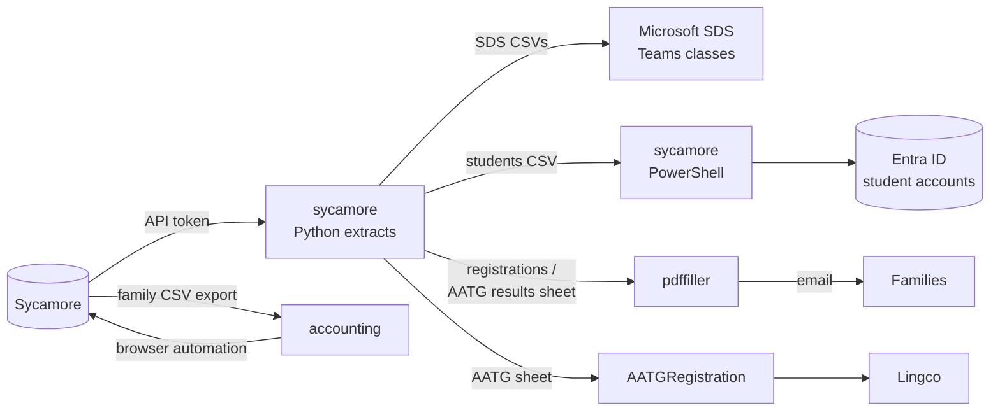

# IT scripts overview

This section covers the code in the [it-gssb GitHub organization](https://github.com/it-gssb).
It's written for software engineers who are new to GSSB: what each repo is
for, when it gets used, and how to run it.

!!! danger "These scripts handle personal data"

    Most of them read or write student and family records: names, emails,
    addresses, passwords. Keep inputs and outputs on your own machine. Never
    commit them, never paste them into issues or chat, and delete them when
    you're done. Pass tokens and passwords on the command line only. Never
    put them in files inside a repo.

## Background

New to GSSB? Read [About GSSB](../about-gssb.md) first. It has the roles,
the school-year calendar, and a glossary.

- **Sycamore** ([sycamoreschool.com](https://www.sycamoreschool.com/)) is
  GSSB's school information system and the source of truth for families,
  students, classes, teachers, and billing.
- **Microsoft 365 / Entra ID** hosts the `student.gssb.org` student accounts.
  **Microsoft School Data Sync (SDS)** turns Sycamore class lists into Teams
  classes.
- The **IT / Registrar** member of the School Committee owns these
  scripts (`it@gssb.org`).
- The **AATG** National German Exam happens once a year. See
  [AATG exam registration](../aatg/index.md).

## Repos

| Repo | Language | Used for | When | Activity |
| :--- | :------- | :------- | :--- | :------- |
| [sycamore](sycamore.md) | Python, PowerShell | Exporting Sycamore data for SDS, Entra accounts, registration lists, AATG | Summer and start of year, then whenever enrollment changes | Active (2026) |
| [pdffiller](pdffiller.md) | Java | Filling PDF forms from a spreadsheet and emailing them in bulk (AATG certificates, enrollment letters) | Acceptance letters (summer), AATG certificates (spring) | Stable (2025) |
| [accounting](accounting.md) | Java | Posting tuition charges to Sycamore family accounts and creating invoices | Once a year, after registration (spring) | Stable (2025) |
| [AATGRegistration](aatg-registration.md) | Python | Creating students' exam accounts with the test provider (Lingco) in bulk | Once a year, before the January exam | Dormant (2023) |
| [it-gssb.github.io](https://github.com/it-gssb/it-gssb.github.io) | Markdown | This site | Any time | Active |

## How they fit together

## Common setup (Windows)

- **Python 3**: install it from [python.org](https://www.python.org/downloads/windows/)
  and run it with the `py` launcher.
- **Java 17 JDK**: required to build `pdffiller` and `accounting`. Both use
  the Gradle wrapper (`gradlew.bat`), so you don't need to install Gradle.
- **Git**: get it from [git-scm.com](https://git-scm.com/download/win), or
  download a repo as a ZIP from GitHub.
- **Sycamore access**: an admin account, and an API access token for the
  Python scripts. Ask the IT team.

## Owner

GSSB IT team. Open an issue in the repo concerned, or ask in the IT
volunteers' channel.

## Last verified

2026-10-24, by GSSB IT team (from reading the repos, not from a test run).
