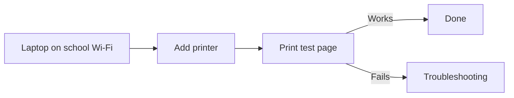

# Formatting examples: Connect a laptop to the classroom printer

!!! info "This is an example"

    This page is a filled-in [how-to](how-to-template.md) that shows the
    formatting available on this site: boxes like this one (admonitions), tabs,
    code blocks, diagrams, and fold-out questions. Click **Edit this page**
    (:material-file-edit-outline:) to see how each one is written, then copy
    what you need.

## Purpose

Add the shared classroom printer to a teacher's or volunteer's laptop so they
can print handouts. Use this when someone gets a new laptop or reports that
the printer has disappeared from their list.

## Prerequisites

- The laptop is connected to the **school Wi-Fi** (not the guest network).
- The printer is switched on and shows *Ready* on its display.
- You know the printer's name as shown on the label on the printer
  (for example `Classroom-Printer`).

!!! warning "Never write passwords on this page"

    If a step needs an admin password, say where to find it (for example
    *"in the password manager under Classroom Printer"*). Never put the
    password itself here. This site is public.

## Steps



1. Confirm the laptop is on the school Wi-Fi.
2. Add the printer:

    === "Settings app"

        1. Open **Start → Settings → Bluetooth & devices → Printers & scanners**.
        2. Click **Add device** and wait for the printer to appear.
        3. Select the printer and click **Add device**.

    === "PowerShell"

        To check the printer was added, open **PowerShell** and run:

        ```powershell
        Get-Printer | Select-Object Name, PrinterStatus
        ```

3. Print a test page and confirm it comes out of the right printer.

## Troubleshooting

??? question "The printer doesn't appear in the list"

    - Check the laptop is on the school Wi-Fi, not the guest network.
    - Power-cycle the printer and wait two minutes before trying again.

??? question "The test page prints garbage or nothing at all"

    Remove the printer from the laptop and add it again. If that doesn't
    help, contact the owner listed below.

## Owner

GSSB IT team. Open an issue in the
[repository](https://github.com/it-gssb/it-gssb.github.io/issues) or ask in
the IT volunteers' channel.

## Last verified

2026-10-24, by the GSSB IT team (example content; not a real procedure).
